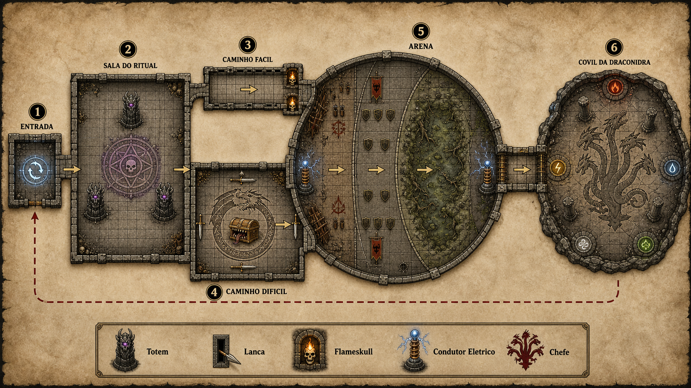

# A Última Dungeon — referência da aventura

## 1. Visão geral

**A Última Dungeon** é uma one-shot de D&D 5e inspirada em roguelikes.

- Grupo: 6 jogadores de nível 3.
- Duração pretendida: aproximadamente 4 horas.
- Estrutura: dungeon curta, encontros muito acima da dificuldade normal e progressão entre tentativas.
- Regra central: quando todo o grupo morre, todos retornam à entrada.
- Persistência: ouro, equipamentos, itens mágicos e melhorias são mantidos entre as runs.
- Intenção de design: o grupo deve morrer algumas vezes, aprender os padrões e comprar ou conquistar poder suficiente para vencer.
- Preferência: utilizar monstros oficiais de D&D 5e.
- Tom mecânico: encontros simples de conduzir, com objetivos claros e uma mecânica marcante em cada sala.
- História, ambientação detalhada, loja e tabela completa de melhorias ainda não foram desenvolvidas.

## 2. Fluxo aprovado

```text
ENTRADA / PONTO DE RETORNO
          |
          v
SALA DO RITUAL
5 Ghasts + 1 Wraith + 3 Totens
          |
          +--------------------------+
          |                          |
          v                          v
CAMINHO FÁCIL                  CAMINHO DIFÍCIL
Corredor de lanças             Dragão de Ouro Jovem
Goblins inacessíveis           Mimic + 4 Flying Swords
2 Flameskulls                  Loot único: Lâmina Solar
          |                          |
          +------------+-------------+
                       |
                       v
                     ARENA
       1. Horda Goblin
       2. Horda de Zumbis
       3. Contemplador Zumbi (subchefe)
                       |
                       v
             COVIL DA DRACONIDRA
                    Chefe final
```

O caminho fácil e o caminho difícil são alternativas e se reconectam antes da arena.

## 3. Mapa conceitual



O mapa é conceitual, não uma planta final pronta para VTT. Ele representa corretamente o fluxo geral, mas as dimensões e a quantidade exata de quadrados ainda devem ser revisadas antes do jogo.

Elementos mostrados:

- Entrada com símbolo de retorno.
- Sala inicial com três totens em torno do círculo de invocação.
- Bifurcação entre os dois caminhos.
- Arena única dividida visualmente em zonas goblin, hobgoblin e pantanosa. A zona do meio agora é da horda de zumbis, não da falange. A zona pantanosa foi desenhada para o Monte Errante e não combina mais com o Contemplador Zumbi; o mapa precisa ser refeito nesse trecho.
- Dois condutores elétricos na arena.
- Covil final com pilares e runas elementais.
- Linha tracejada indicando o retorno à entrada após um TPK.

## 4. Regra de reinício

Quando todos os personagens morrem:

1. O grupo retorna à entrada.
2. Os personagens continuam no nível 3, salvo decisão futura em contrário.
3. Todo ouro adquirido permanece com o grupo.
4. Equipamentos, itens mágicos e melhorias permanentes também permanecem.
5. Salas e inimigos retornam ao estado inicial na nova run.
6. O conhecimento dos padrões dos encontros é parte da progressão.

Ainda não foi definido:

- Se recursos de classe, espaços de magia e PV são completamente restaurados no reinício.
- Se consumíveis gastos retornam ou permanecem consumidos. A recomendação para preservar a economia roguelike é que permaneçam consumidos.
- Se existe descanso curto ou longo entre encontros.
- Se o grupo pode retornar voluntariamente à entrada sem morrer.
- Como evitar que uma run seja abandonada apenas para farmar as primeiras salas.

## 5. Encontro 1: Sala do Ritual

### Monstros

- 5 Ghasts.
- 1 Wraith.
- 3 totens necromânticos interativos.
- 1 Bone Devil potencialmente invocado.

### Objetivo

Destruir os totens e interromper o ritual antes do fim da terceira rodada, enquanto o grupo enfrenta os mortos-vivos.

### Mecânica especial

- Os três totens mantêm uma mecânica de ressurreição dos inimigos caídos.
- O conceito original era que os totens, em conjunto, reanimassem até três mortos por rodada enquanto permanecessem ativos.
- Se o ritual não for interrompido em três rodadas, um Bone Devil é invocado no centro dos totens.
- Impedir a invocação concede a recompensa em ouro do Bone Devil. O grupo não é punido por resolver corretamente a mecânica.

### Dificuldade pretendida

- Muito alta para seis personagens de nível 3.
- A invocação do Bone Devil deve funcionar como condição de desastre ou quase-TPK, não como uma segunda fase rotineiramente equilibrada.

### Tentativas futuras

- O grupo conhece a prioridade dos totens.
- Pode dividir funções entre controle dos mortos-vivos, dano nos totens e interrupção do ritual.
- Melhorias persistentes devem transformar uma sala inicialmente opressiva em um encontro rápido nas runs posteriores.

### Pendente

A versão exata da ressurreição ainda precisa ser fechada. É necessário definir:

- Quantos mortos cada totem reanima.
- Em qual contagem de iniciativa isso acontece.
- Se Ghasts e Wraith podem ser reanimados ou apenas os Ghasts.
- CA, PV, imunidades e vulnerabilidades dos totens.
- Se destruir um totem reduz a quantidade de criaturas reanimadas.

Sugestão simples compatível com o conceito: cada totem ativo reanima um Ghast caído com metade dos PV no fim da rodada; o Wraith não pode ser reanimado.

## 6. Caminho fácil: Corredor das Lanças

### Ameaças

- Goblins escondidos atrás de paredes, inalcançáveis pelos personagens.
- Lanças atravessando frestas nas paredes.
- 2 Flameskulls posicionados para atacar personagens que ficarem para trás.

### Objetivo

Atravessar correndo um corredor de cinco quadrados.

### Mecânica especial

- Cada personagem faz um teste de Destreza CD 15 para atravessar.
- Em caso de falha, sofre 10 pontos de dano.
- Em caso de sucesso, sofre metade: 5 pontos de dano.
- Em um resultado total inferior a 5, o personagem cai no corredor e se torna alvo de uma Fireball.
- Em uma falha crítica, os dois Flameskulls percebem a oportunidade e lançam duas Fireballs sobre o personagem.
- Os goblins não podem ser atingidos; o desafio consiste em correr e sobreviver.
- Os Flameskulls atacam quem demora, cai ou fica isolado.

### Dificuldade pretendida

- É o caminho relativamente fácil, não um caminho seguro.
- O principal perigo é um personagem cair e receber dano concentrado dos Flameskulls.

### Tentativas futuras

- O grupo já sabe que não deve tentar combater os goblins.
- Pode preparar bônus de salvaguarda, resistência a fogo, mobilidade e meios de ajudar rapidamente quem cair.

### Recompensa

- Os dois Flameskulls concedem a recompensa mesmo se o grupo atravessar rápido e impedir que ataquem.
- Os goblins atrás das paredes são tratados como parte da armadilha e não possuem recompensa individual definida.

### Pendente

- Confirmar se o teste é uma única salvaguarda por personagem ou uma salvaguarda por trecho.
- Definir o que significa exatamente "falha crítica": 1 natural ou resultado total abaixo de algum valor.
- Definir iniciativa e área exata das Fireballs.
- Revisar o corredor de cinco quadrados, pois personagens com deslocamento de 30 pés normalmente atravessam 25 pés sem usar Dash.

## 7. Caminho difícil: Câmara do Tesouro

### Monstros

- 1 Young Gold Dragon (Dragão de Ouro Jovem).
- 1 Mimic disfarçado de baú.
- 4 Animated Flying Swords instaladas ou penduradas nas paredes.

### Objetivo

Sobreviver à sala e conquistar o tesouro guardado pelo Mimic.

### Mecânica especial

- O Dragão de Ouro está enrolado em torno do suposto baú.
- O baú é o Mimic.
- As quatro espadas nas paredes se animam como Animated Flying Swords.
- O loot único do Mimic é uma Lâmina Solar.

### Dificuldade pretendida

- Extremamente alta para o nível 3.
- Este caminho existe para oferecer uma recompensa transformadora, não para ser tão eficiente quanto o caminho fácil.

### Tentativas futuras

- Depois de conquistar a Lâmina Solar, o grupo a mantém entre as runs e não precisa repetir este caminho.
- Conhecer a identidade do Mimic e a ativação das espadas permite preparar uma abertura melhor.

### Recompensas

- Dragão de Ouro Jovem: recompensa especial de `1d100 + 100` PO.
- Mimic: `1d8 + 8` PO e a Lâmina Solar.
- Quatro Animated Flying Swords: `4d4 + 16` PO no total.

### Pendente importante

O Young Gold Dragon oficial possui alinhamento e comportamento normalmente benevolentes. A razão para ele atacar personagens ainda precisa ser definida. Possibilidades:

- Guardião obrigado por magia.
- Ilusão ou construção que usa a ficha do dragão.
- Dragão corrompido.
- Prova não letal interpretada mecanicamente como combate.
- Negociação ou roubo como solução alternativa.

Também falta definir se superar o dragão sem matá-lo concede sua recompensa especial. A regra geral de recompensar ameaças neutralizadas sugere que sim, desde que o objetivo da sala seja cumprido.

## 8. Arena: estrutura geral

A arena contém três encontros consecutivos no mesmo espaço:

1. Horda Goblin.
2. Horda de Zumbis.
3. Contemplador Zumbi como subchefe.

Objetivo de ritmo: produzir escala e desgaste sem administrar dezenas de iniciativas individuais.

Regra de condução sugerida:

- Usar apenas três blocos de iniciativa quando houver hordas: linha de frente, arqueiros e líder.
- Rolar ataques de criaturas iguais em conjunto, usando dados de cores diferentes.
- Usar o dano médio quando necessário para acelerar a sessão.
- Inimigos que fogem em razão do objetivo cumprido contam como derrotados para a recompensa.

Ainda não foi decidido se existe pausa, cura ou compra entre as três fases da arena.

## 9. Arena 1: Horda Goblin

### Monstros

- 12 Goblin Warriors.
- 1 Goblin Boss.

### Objetivo

Matar o Goblin Boss antes que todos os reforços entrem.

### Fases e mecânica especial

#### Fase inicial

- Goblin Boss.
- 3 goblins corpo a corpo.
- 3 goblins arqueiros.

#### Fim da rodada 1

- Entram mais 3 goblins enquanto o Boss estiver vivo.

#### Fim da rodada 2

- Entram os últimos 3 goblins enquanto o Boss estiver vivo.

#### Liderança

- O Boss usa Redirect Attack para colocar goblins próximos entre ele e ataques recebidos.
- Quando o Boss morre, os reforços param de entrar.
- Os goblins restantes fogem ao final da rodada em que o Boss morrer.
- Goblins que fogem dessa forma concedem sua recompensa normalmente.

### Dificuldade pretendida

- Alta.
- Quase mortal se todos os doze goblins entrarem e conseguirem concentrar ataques.

### Tentativas futuras

- O grupo conhece as entradas dos reforços.
- Aprende que eliminar o Boss encerra rapidamente o encontro.
- Pode preparar controle de área para as entradas.

### Ligação temática

Estes goblins podem ser apresentados como a mesma força responsável pelas lanças do caminho fácil.

## 10. Arena 2: Horda de Zumbis

### Monstros

- 10 Zombies, em dois grupos de cinco.
- 1 Hobgoblin Captain, que continua no comando.

Substituiu os 6 Hobgoblin Warriors. O Capitão ficou: é ele que dispara os
condutores elétricos da arena ao cair (§11), e sem ele a Arena 2 perderia a fase
de "queda do líder" que amarra os dois encontros.

### Objetivo

Aguentar a pressão dos números e derrubar o Capitão.

### Como conduzir

Os zumbis são conduzidos **como mob, não um a um**: cada grupo de cinco vira uma
barra só, com os `75` PV somados, e a tela de Monstros mostra ao lado quantos
ainda estão de pé. É o número que importa na hora de decidir quantos Slams saem
no turno — dez fichas separadas na tela não acrescentariam nada e custariam
tempo de mesa.

### Fases e mecânica especial

#### Fase inicial

- Capitão atrás.
- Grupo A avança pela frente; grupo B fica em reserva.
- O Capitão fica dentro do alcance da Aura of Authority do grupo da frente: na emanação de 10 pés, ele e os zumbis têm vantagem em ataques e salvaguardas.

#### Fase de avanço

- Quando o Capitão chega à metade dos PV, manda o grupo B entrar.
- Os dois grupos passam a cercar, mas sem sair da aura — o que os mantém compactos e os torna alvo de área.

#### Queda do Capitão

- A Aura of Authority some com ele.
- Os zumbis não fogem: são mortos-vivos sem vontade própria. Seguem avançando até o último cair.
- Os condutores elétricos da Arena 3 ligam (§11).

### Mecânica especial: Undead Fortitude

É o que dá peso a uma horda de ND 1/4. Todo zumbi reduzido a 0 PV faz uma
salvaguarda de Constituição CD 5 + o dano sofrido e volta com 1 PV se passar —
a menos que o dano seja radiante ou venha de um acerto crítico. Na prática:

- Golpe pequeno derruba e o zumbi levanta; golpe grande derruba de vez, porque a CD sobe com o dano.
- A **Lâmina Solar** encerra o traço de uma vez, e é aqui que ela mais aparece na aventura fora do chefe final.
- Conduzindo como mob, a salvaguarda vale por criatura, não por barra: cada vez que o dano acumulado cruza um múltiplo de 15, role uma vez.

### Dificuldade pretendida

- Mortal, especialmente após o desgaste da horda goblin.
- O perigo mudou de qualidade: a falange batia forte e pouco, a horda bate fraco e sempre. Vinte ataques de `+3` por rodada acertam alguém.

### Tentativas futuras

- O grupo aprende que dano radiante e críticos valem o dobro aqui.
- Aprende a segurar os zumbis num gargalo, já que o deslocamento deles é `20 pés`.
- Controle de área e deslocamento forçado ganham grande valor.

## 11. Subchefe: Contemplador Zumbi

### Monstro

- 1 Beholder Zombie, chamado de Contemplador Zumbi em português neste projeto.

Substituiu o Shambling Mound (Monte Errante). A escolha passou antes pelo
Beholder inteiro, mais clássico, mas ele é ND 13 — um salto grande demais para a
posição. O Beholder Zombie é ND 5, exatamente o do Monte Errante, então a
dificuldade da Arena III continua onde estava e nenhum número da seção 13 mudou.

### Objetivo

Derrubar o Contemplador Zumbi antes que os raios desmontem a formação do grupo.

### Mecânica especial

- **Undead Fortitude.** Reduzido a 0 PV, faz uma salvaguarda de Constituição CD 5 + o dano sofrido e fica com 1 PV se passar. Não vale contra dano radiante nem contra acerto crítico. É a mecânica marcante da sala e o gancho direto da Lâmina Solar: sem dano radiante, o grupo precisa derrubar o zumbi várias vezes; com ela, cai de uma vez.
- **Eye Rays aleatórios.** Dois por turno, sorteados em `1d4` sem repetir no mesmo turno. O mestre não escolhe — a tela de Monstros tem o botão para isso. Os quatro raios são Paralyzing, Fear, Enervation e Disintegration, todos CD 14.
- **Disintegration Ray** é o único que ameaça matar de vez: 27 (5d10) de dano de força e, se levar o alvo a 0 PV, ele vira pó. Um em quatro por raio, dois raios por turno.
- **Ação única por rodada.** Sem ações lendárias, sem cone antimagia e sem Legendary Resistance — diferente do Beholder vivo, este é um solo comum contra seis personagens, e a economia de ações pesa contra ele. Se cair rápido demais na mesa, o ajuste natural é somar algo à arena, não inflar a ficha.
- **Os dois condutores elétricos continuam sem função definida.** Existiam para curar o Monte Errante por Lightning Absorption; o zumbi não tem interação nenhuma com dano elétrico. Ou viram perigo de terreno puro, ou saem do mapa.

### Dificuldade pretendida

- Subchefe perigoso depois de duas batalhas consecutivas, mas dentro do padrão do resto da dungeon — não é o muro que o Beholder inteiro seria.
- O encontro deve recompensar dano radiante concentrado e distância dos raios.

### Tentativas futuras

- O grupo aprende que a Lâmina Solar encerra o Undead Fortitude e prioriza quem a carrega.
- Aprende que crítico também ignora o traço, o que dá valor a vantagem em ataque.
- Aprende a se espalhar: os raios pegam um alvo por vez, então aglomerar não ajuda, mas ficar longe reduz a mordida.

### Recompensa

- Recompensa especial de `1d100 + 100` PO, a mesma do Monte Errante.
- O ouro só é recebido quando o Contemplador Zumbi for derrotado ou neutralizado; apenas chegar até ele não concede a recompensa.

### Pendente

- O que fazer com os dois condutores elétricos, que perderam a função original: sumir do mapa ou virar dano de terreno puro.
- Se o encontro precisa de reforço, já que o subchefe agora age uma vez por rodada contra seis personagens.
- Qual miniatura usar: a do Monte Errante não serve mais e a substituta ainda não foi escolhida.

## 12. Chefe final: Draconidra

### Monstro

- 1 Dracohydra, ND 11, de *Fizban's Treasury of Dragons*.

### Objetivo

Derrotar todas as cabeças e encerrar a aventura.

### Mecânicas definidas

- Dano radiante impede o crescimento de novas cabeças conforme a mecânica adotada para o encontro.
- O sopro prismático deve ser anunciado antes de acontecer, permitindo reposicionamento.
- O padrão elemental do sopro deve ser fixo e aprendível entre runs, em vez de completamente aleatório.
- A Lâmina Solar conquistada no caminho difícil é a principal ferramenta persistente contra a regeneração.

### Dificuldade pretendida

- Chefe final deliberadamente muito acima do nível normal do grupo.
- A vitória deve depender de conhecimento acumulado, melhorias permanentes, consumíveis e execução coordenada.

### Recompensa

- Não concede ouro.
- Derrotá-la encerra o jogo, portanto uma recompensa econômica posterior não teria função.

### Observação de regra

A Draconidra oficial é uma Monstrosidade, não uma criatura do tipo Dragão. Por isso, uma Dragon Slayer não recebe automaticamente seu bônus contra ela sem uma alteração do mestre.

### Pendente

- Confirmar a ficha e redação exatas que serão usadas na mesa.
- Definir o padrão fixo dos tipos de sopro.
- Definir como o sopro é telegrafado visualmente.
- Definir cobertura, pilares, runas e limites da arena final.
- Decidir se a ficha oficial será reduzida ou se as melhorias dos personagens carregarão todo o balanceamento.

## 13. Economia de ouro

### Regra geral

Cada ameaça concede ouro conforme sua dificuldade:

| Faixa | ND de referência | Recompensa por criatura | Média |
|---|---:|---:|---:|
| Baixa | 0 a 1 | `1d4 + 4` PO | 6,5 PO |
| Média | 2 a 4 | `1d8 + 8` PO | 12,5 PO |
| Alta | 5 a 10 | `1d20 + 20` PO | 30,5 PO |
| Especial | Marco escolhido pelo mestre | `1d100 + 100` PO | 150,5 PO |

A faixa especial foi atribuída ao Dragão de Ouro Jovem e ao Contemplador Zumbi. Ela é um marco escolhido pelo mestre, não uma consequência do ND. A Draconidra não concede ouro.

### Regra contra punição por boa estratégia

A recompensa é concedida quando a ameaça é:

- Morta.
- Impedida de aparecer.
- Neutralizada.
- Afugentada pelo cumprimento do objetivo.
- Superada de maneira que conclua o encontro.

Aplicações aprovadas:

- Impedir o ritual concede o ouro do Bone Devil.
- Matar o Goblin Boss e provocar a fuga da horda concede o ouro dos goblins restantes.
- Matar o Hobgoblin Captain concede o ouro dele. Os zumbis não recuam — o ouro dos dez sai por criatura derrubada, como sempre.
- Atravessar eficientemente o corredor concede a recompensa dos Flameskulls mesmo que não consigam atacar.

### Recompensas por encontro

| Encontro | Inimigo | Qtd. | ND | Faixa | Ouro unitário | Ouro total | Média total |
|---|---|---:|---:|---|---:|---:|---:|
| Sala inicial | Ghast | 5 | 2 | Média | `1d8+8` | `5d8+40` | 62,5 |
| Sala inicial | Wraith | 1 | 5 | Alta | `1d20+20` | `1d20+20` | 30,5 |
| Ritual | Bone Devil | 1 | 9 | Alta | `1d20+20` | `1d20+20` | 30,5 |
| Caminho fácil | Flameskull | 2 | 4 | Média | `1d8+8` | `2d8+16` | 25 |
| Caminho difícil | Young Gold Dragon | 1 | 10 | Especial | `1d100+100` | `1d100+100` | 150,5 |
| Caminho difícil | Mimic | 1 | 2 | Média | `1d8+8` | `1d8+8` | 12,5 |
| Caminho difícil | Animated Flying Sword | 4 | 1/4 | Baixa | `1d4+4` | `4d4+16` | 26 |
| Arena 1 | Goblin Warrior | 12 | 1/4 | Baixa | `1d4+4` | `12d4+48` | 78 |
| Arena 1 | Goblin Boss | 1 | 1 | Baixa | `1d4+4` | `1d4+4` | 6,5 |
| Arena 2 | Zombie | 10 | 1/4 | Baixa | `1d4+4` | `10d4+40` | 65 |
| Arena 2 | Hobgoblin Captain | 1 | 3 | Média | `1d8+8` | `1d8+8` | 12,5 |
| Subchefe | Beholder Zombie | 1 | 5 | Especial | `1d100+100` | `1d100+100` | 150,5 |
| Chefe final | Dracohydra | 1 | 11 | Final | - | Sem ouro | 0 |

### Quatro runs pelo caminho fácil

Hipóteses usadas:

- O grupo completa a sala inicial.
- Impede ou derrota o Bone Devil e recebe sua recompensa.
- Passa pelo caminho fácil.
- Completa as duas batalhas da arena.
- Chega ao Contemplador Zumbi, mas não necessariamente o derrota.
- Todos os encontros pagam recompensa integral novamente em cada run.

Média por run antes de derrotar o Contemplador Zumbi:

| Trecho | Média |
|---|---:|
| Sala inicial, incluindo Bone Devil impedido | 123,5 PO |
| Caminho fácil | 25 PO |
| Horda Goblin | 84,5 PO |
| Horda de Zumbis | 77,5 PO |
| **Total** | **310,5 PO** |

Resultados em quatro runs:

- Média acumulada: **1.242 PO**.
- Mínimo possível: **916 PO**.
- Máximo possível: **1.568 PO**.
- Se derrotarem o Contemplador Zumbi apenas na quarta run: média de **1.392,5 PO**.
- Se derrotarem o Contemplador Zumbi em todas as quatro runs: média de **1.844 PO**.

### Regra de repetição não adotada

Foi sugerido que encontros já vencidos pagassem metade nas runs seguintes para evitar farm infinito, mas essa regra não foi confirmada. Todos os cálculos atuais presumem pagamento integral em todas as runs.

## 14. Item mágico principal: Lâmina Solar

### Aquisição

- A Lâmina Solar é o loot único do Mimic no caminho difícil.
- Não precisa ser comprada.
- Depois de adquirida, permanece com o grupo após os reinícios.
- O grupo não precisa repetir o caminho difícil para mantê-la.

### Razões da escolha

- É uma arma rara que exige sintonização.
- Funciona como uma longsword com Finesse.
- Concede `+2` nas jogadas de ataque e dano.
- Causa dano radiante em vez de cortante.
- Causa `+1d8` de dano radiante contra mortos-vivos.
- É excelente contra Ghasts e Wraith.
- Continua sendo uma arma forte contra goblins, o Capitão hobgoblin, o Mimic e o Bone Devil.
- Contra a horda de zumbis da Arena 2 é decisiva: dano radiante desliga o Undead Fortitude dos dez.
- Contra o Contemplador Zumbi é a resposta planejada: dano radiante desliga o Undead Fortitude dele.
- O dano radiante é a resposta planejada para impedir o crescimento das cabeças da Draconidra.

### Itens discutidos, mas não escolhidos como recompensa principal

- Cloak of Protection.
- Potion of Heroism.
- Potion of Invulnerability.
- Potion of Speed.
- Wand of Magic Missiles.
- Necklace of Fireballs.
- Armas `+1`.

Esses itens podem futuramente compor a loja ou a tabela de melhorias.

## 15. Fontes de regras e fichas

As fichas usadas são as do Monster Manual de 2025 (`XMM`), alinhadas com o conjunto de regras revisado de 2024. A única exceção é a Draconidra, que não foi refeita em 2025 e continua na versão de Fizban's Treasury of Dragons.

Duas criaturas ainda em uso mudaram de nome na virada e os links já apontam para o nome novo: Flying Sword virou **Animated Flying Sword** e Goblin virou **Goblin Warrior**. O Hobgoblin Captain saiu do Volo's Guide para o Monster Manual. Os `id` internos do webapp continuam os antigos, porque casam com a calculadora de loot.

### Monstros

- [Ghast](https://5e.tools/bestiary/ghast-xmm.html)
- [Wraith](https://5e.tools/bestiary/wraith-xmm.html)
- [Bone Devil](https://5e.tools/bestiary/bone-devil-xmm.html)
- [Flameskull](https://5e.tools/bestiary/flameskull-xmm.html)
- [Young Gold Dragon](https://5e.tools/bestiary/young-gold-dragon-xmm.html)
- [Mimic](https://5e.tools/bestiary/mimic-xmm.html)
- [Animated Flying Sword](https://5e.tools/bestiary/animated-flying-sword-xmm.html)
- [Goblin Warrior](https://5e.tools/bestiary/goblin-warrior-xmm.html)
- [Goblin Boss](https://5e.tools/bestiary/goblin-boss-xmm.html)
- [Zombie](https://5e.tools/bestiary/zombie-xmm.html)
- [Hobgoblin Captain](https://5e.tools/bestiary/hobgoblin-captain-xmm.html)
- [Beholder Zombie](https://5e.tools/bestiary/beholder-zombie-xmm.html)
- [Dracohydra](https://5e.tools/bestiary/dracohydra-ftd.html)

### O que a virada de 2025 mudou no balanceamento

Nenhum ND mudou, então a economia de ouro da seção 13 continua válida. O que mudou e afeta a mesa:

- **Hobgoblin Captain:** ganhou PV (39 → 58) e trocou Leadership e Martial Advantage por Aura of Authority, uma emanação de 10 pés que dá vantagem em ataques e salvaguardas a ele e aos aliados dentro dela.
- **Bone Devil:** CA 19 → 16 e PV 142 → 161; o ferrão ficou mais forte e agora impede o alvo de recuperar PV enquanto envenenado.
- **Flameskull:** perdeu o repertório de mago (`shield`, `blur`, `flaming sphere`) e ficou com `fireball` uma vez por dia, `magic missile` duas e `mage hand` à vontade. Em compensação o Fire Ray subiu para `3d6 + 3` e alcança 60 pés.
- **Wraith:** o Life Drain reduz o máximo de PV **sem salvaguarda**.
- **Goblin Warrior:** 7 → 10 PV, e os ataques somam `1d4` quando a rolagem teve vantagem.
- **Animated Flying Sword:** perdeu Antimagic Susceptibility e False Appearance; antimagia não desliga mais as espadas da Câmara do Tesouro.
- **Mimic:** perdeu False Appearance e Grappler; agarra pelo Pseudopod e morde mais forte em quem já está agarrado.
- **Ghast:** perdeu Turn Defiance, a paralisia da garra dura só até o fim do próximo turno do alvo, e a mordida virou perfurante + necrótico.

### Itens mágicos revisados

- [Magic Items A-Z, Basic Rules 2024](https://www.dndbeyond.com/sources/dnd/br-2024/magic-items-a-z)
- [Sun Blade](https://www.dndbeyond.com/sources/dnd/br-2024/magic-items-a-z#SunBlade)

### Modelos STL escolhidos

Seleção feita para impressão FDM em uma impressora Bambu Lab. Quando disponível, deve-se priorizar o perfil indicado no MakerWorld e abri-lo diretamente no Bambu Studio.

- **Ghast — 5 miniaturas:** [Ghast Set (3 Variants) — Undead Beasts](https://makerworld.com/en/models/2360934-dnd-ghast-set-3-variants-undead-beasts) — MakerWorld; três variantes em placas separadas e uma placa com o conjunto completo.
- **Wraith — 1 miniatura:** [The Wraith Pack — 4 Miniatures FDM Dungeon Masters](https://makerworld.com/en/models/1442891-the-wraith-pack-4-miniatures-fdm-dungeon-masters) — MakerWorld; conjunto projetado para FDM.
- **Bone Devil — 1 miniatura:** [DnD Bone Devil — D&D Monster Manual, Day 53](https://makerworld.com/en/models/2506759-dnd-bone-devil-d-d-monster-manual-day-53) — MakerWorld; possui perfis com e sem base.
- **Flameskull — 2 miniaturas:** [Flameskull | Demilich](https://makerworld.com/en/models/2681283-flameskull-demilich) — MakerWorld; perfil de `0,08 mm`, 2 paredes e 15% de preenchimento, com duração estimada de 53 minutos por placa.
- **Young Gold Dragon — 1 miniatura:** [Gold Dragon 2025](https://www.printables.com/model/1243302-gold-dragon-2025/files) — Printables, por MZ4250; usar o arquivo do Young Gold Dragon e preferir a versão dividida em peças para FDM.
- **Mimic — 1 miniatura:** [Mimic & Treasure Chests Set](https://makerworld.com/en/models/2157348-mimic-treasure-chests-set#profileId-2338719) — MakerWorld; conjunto sem suportes com um Mimic e dois baús, perfil de `0,1 mm`, 2 paredes e 15% de preenchimento.
- **Flying Sword — 4 miniaturas:** [DnD Flying Sword Construct — D&D Monster Manual](https://makerworld.com/en/models/2257261) — MakerWorld; perfil de `0,12 mm`, 4 paredes e 10% de preenchimento.
- **Goblin — 12 miniaturas:** [Fast 5 Goblin Supportless Miniature Pack](https://makerworld.com/en/models/1642172-fast-5-goblin-supportless-miniature-pack) — MakerWorld; cinco variantes sem suportes, otimizadas para FDM e bicos de 0,2 ou 0,4 mm.
- **Goblin Boss — 1 miniatura:** [Goblin King with Crown and Staff](https://makerworld.com/en/models/2518398-goblin-king-with-crown-and-staff) — MakerWorld; perfil de `0,2 mm`, 2 paredes e 15% de preenchimento.
- **Zombie — 10 miniaturas:** ainda não escolhida. O modelo do Hobgoblin Warlord saiu da lista com a troca da Arena 2.
- **Hobgoblin Captain — 1 miniatura:** [D&D Hobgoblin Captain](https://makerworld.com/en/models/2720746-d-d-hobgoblin-captain) — MakerWorld; a página inclui fotografias da impressão real.
- **Beholder Zombie — 1 miniatura:** ainda não escolhida. O modelo do Shambling Mound saiu da lista com a troca do subchefe.
- **Dracohydra — 1 miniatura:** [Five-Headed Dragon — RPG Boss](https://makerworld.com/en/models/2722219-five-headed-dragon-rpg-boss) — MakerWorld; modelo gratuito de cinco cabeças usado como Dracohydra, com impressão real em PLA numa Bambu Lab e perfil de `0,2 mm`, 2 paredes e 15% de preenchimento, com duração estimada de 5,1 horas em uma placa.

## 16. Decisões substituídas

Estas ideias apareceram anteriormente, mas foram substituídas e não fazem parte da versão atual:

- Esqueletos na sala inicial.
- Três totens reanimando esqueletos.
- Minotauro Esqueleto invocado na sala inicial.
- Seis Ghouls na sala inicial.
- Hydra comum como chefe final.
- Dragon Slayer como principal ferramenta contra o chefe.
- Três caminhos opcionais; a versão atual possui apenas caminho fácil e difícil.
- Subchefe em sala separada; o subchefe agora acontece na própria arena.
- Shambling Mound (Monte Errante) como subchefe; trocado por um beholder-kin.
- Falange Hobgoblin (6 Hobgoblin Warriors) na Arena 2; trocada por uma horda de 10 zumbis conduzida como mob. O Capitão ficou.
- Beholder inteiro como subchefe; ND 13 era um salto grande demais para a posição, e ficou o Beholder Zombie, de ND 5.

## 17. Principais pendências para o próximo agente

Prioridade alta:

1. Fechar as estatísticas e o funcionamento dos três totens.
2. Fechar a mecânica do corredor e esclarecer falha, queda e falha crítica.
3. Definir a razão narrativa ou solução alternativa para enfrentar um Dragão de Ouro Jovem.
4. Decidir o destino dos dois condutores elétricos, que perderam a função com a saída do Monte Errante.
5. Definir o padrão telegráfico e elemental do sopro da Draconidra.
6. Criar a loja e as melhorias permanentes usando a economia já calculada.
7. Definir descansos, restauração no reset e persistência de consumíveis.
8. Simular o tempo total; há muitos combates para uma janela de quatro horas.

Prioridade média:

1. Transformar o mapa conceitual em mapa de batalha com dimensões exatas.
2. Definir ordem de iniciativa e gatilhos de todas as fases.
3. Criar cartões curtos de referência para cada encontro.
4. Definir condições de vitória alternativas além de matar criaturas.
5. Reavaliar a dificuldade da Arena 2 com a horda de zumbis: vinte ataques por rodada contra seis personagens é outro tipo de pressão, e o Undead Fortitude alonga o encontro.
6. Estabelecer preços para consumíveis e melhorias.

## 18. Riscos de design

- A quantidade de encontros pode exceder quatro horas, mesmo com múltiplas runs.
- Os encontros são letais demais para nível 3 se as melhorias não forem fortes e rapidamente acessíveis.
- Muitos inimigos individuais podem tornar a arena lenta; iniciativas agrupadas são essenciais.
- Fireball contra personagens de nível 3 pode causar morte imediata ou TPK, especialmente em dose dupla.
- Wraith, Bone Devil, Young Gold Dragon e Dracohydra estão muito acima do padrão de dificuldade do grupo.
- A recompensa integral em todas as runs permite farmar as primeiras salas indefinidamente.
- A Lâmina Solar resolve a regeneração para apenas um portador; o grupo ainda precisa de formas secundárias de causar dano radiante ou proteger esse personagem.
- O caminho difícil pode se tornar obrigatório, apesar de ser apresentado como opcional, porque contém a resposta mais direta ao chefe final.

Esses riscos parecem intencionais em parte, mas precisam ser testados para garantir que o jogo permaneça difícil sem depender exclusivamente de sorte.

## 19. Próximo entregável recomendado

O próximo passo mais útil é criar a loja roguelike e uma tabela de melhorias persistentes. Ela deve ser calibrada para que:

- A primeira run compre ao menos uma melhoria pequena.
- Duas ou três runs permitam sobreviver de forma consistente à arena.
- Quatro runs pelo caminho fácil gerem aproximadamente 1.242 PO.
- A Lâmina Solar continue sendo uma recompensa exclusiva do caminho difícil, não um item da loja.
- Consumíveis ofereçam uma forma de converter ouro excedente em poder para a tentativa final.

